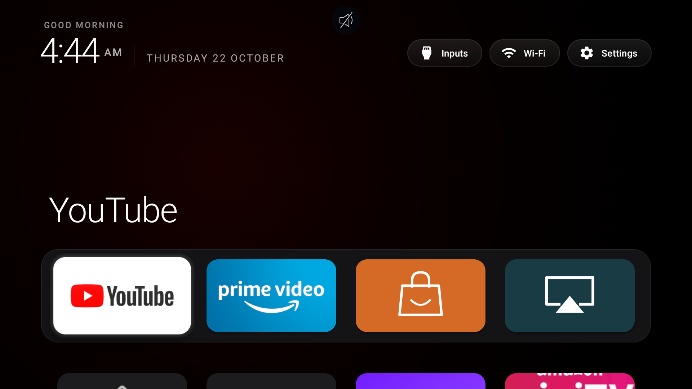

# Insignia Clean Home

A small, offline Fire TV home screen derived from [CleanYourTV](https://github.com/Gathin23/cleanyourtv), adapted on an **Insignia NS-50F501NA26 (AFTHY7ABBA), Fire OS 8.1.8.0 / RS8180/3729, Android 11 / SDK 30**.

Amazon Home remains installed, enabled and the system default. A narrowly scoped accessibility service watches for `com.amazon.tv.launcher.ui.HomeActivity_vNext` and opens this home screen. This is a Home redirect, not a replacement of Fire OS's protected default launcher. No root, patched system apps or disabled stock Home are required.



## What changes from CleanYourTV

- Four main tiles: YouTube, Prime Video, Amazon Appstore and AirPlay; the remaining launchable apps appear below. Android backend services and factory/test tools are filtered out.
- Long-press an app for Open, App info or the system uninstall confirmation. Built-in system apps cannot be removed here. Nothing is silently uninstalled.
- Insignia/MediaTek HDMI inputs open through a native `TvView`. HDMI 3 with a PS5 was tested; waking a sleeping PS5 is not guaranteed.
- Time-based greeting, softer focus shadows and a compact dock. Android system fonts are used; no Apple UI Kit assets or Apple fonts are included.
- Accessibility Home redirect restricted to Amazon Home window events. It does not request remote-key filtering or access to window contents.

## Build and install

Requires JDK 17 or newer, Android SDK platform 34, build-tools 34.0.0, and platform-tools `adb` on PATH. Set `JAVA_HOME` and `ANDROID_HOME` for your local installation (or use an untracked `launcher/local.properties` with `sdk.dir=...`). Gradle downloads the dependencies declared in the build files.

```sh
./build.command
adb connect YOUR_TV_IP:5555
# Accept the debugging prompt on your own TV, then:
python3 tv-home.py install --serial YOUR_TV_IP:5555
```

The installer checks for the tested AFTHY7ABBA / SDK 30 model, installs the locally built APK and enables only this app's accessibility service, preserving other enabled services. It does not disable packages or change the system Home default. The release build uses your local Android debug signing key for personal sideloading; updates must use that same key. APKs and signing keys are not distributed.

Edit `launcher/app/src/main/res/values/config.xml` to customize the dock, labels, hidden apps or optional greeting name before building. The application ID remains `com.jack.insigniahome`; the upstream Java namespace is retained.

## Return to Amazon Home

```sh
python3 tv-home.py restore --serial YOUR_TV_IP:5555
```

This removes only our service from the enabled accessibility list, stops our app and opens the original Home. It leaves the app installed and preserves other accessibility services. Alternatively turn off Insignia Home in Fire TV's accessibility settings. Do not disable or uninstall Amazon's launcher: its settings and the Home fallback are still needed.

## Tested scope and limitations

Observed on the real TV: installation, software-injected Home redirect, app launch/catalog, the Appstore entry, app long-press and native uninstall confirmation (cancelled), and HDMI 3 playback with a PS5. The owner confirmed HDMI selection works. The device has Alexa and AirPlay; their packages are retained, but this is not a complete regression certification of every feature.

Cold-boot/restart persistence and physical remote Home timing have **not been conclusively validated**. An Amazon Home frame or delay may be visible during handoff. A force-stop or a firmware change can disable or break the accessibility redirect; re-enable the service or use Amazon Home. Other Fire TV models and firmware are untested. This project does not fix TV audio faults, remove advertisements inside streaming apps, or promise system-wide ad blocking.

## Permissions and privacy

No `INTERNET` permission, analytics, telemetry, accounts, network requests or periodic polling. The launcher reads launchable apps locally through manifest package queries, and `REQUEST_DELETE_PACKAGES` opens Android's confirmation UI only. Network/Wi-Fi state permissions support the inherited status display; optional location permission supports displaying the Wi-Fi name and is not granted by this installer. The inherited Yandex input permission is unused on this TV. The theme provider requires `WRITE_SECURE_SETTINGS` from its caller; the app is not granted that permission.

`HomeKeyService` is an accessibility service that observes window-state events from Amazon's launcher only. Other inherited optional input helpers are not enabled by the installer. Settings/layout preferences remain on the TV. The computer's `adb` handles the connection and credentials; do not publish keys, account screenshots or device dumps. Turn ADB debugging off when finished.

## Attribution and license

Based on CleanYourTV commit [`0ed6c5b`](https://github.com/Gathin23/cleanyourtv/commit/0ed6c5bccc0b1894051a75c3ec52034b1974e2a0). The Java launcher, Gradle configuration and bundled Outfit font originate upstream. See [LICENSE](LICENSE) (MIT, original copyright retained) and [font license](launcher/FONT-LICENSE-OFL.txt). Insignia-specific integration and configuration by [yjack-coder](https://github.com/yjack-coder).
